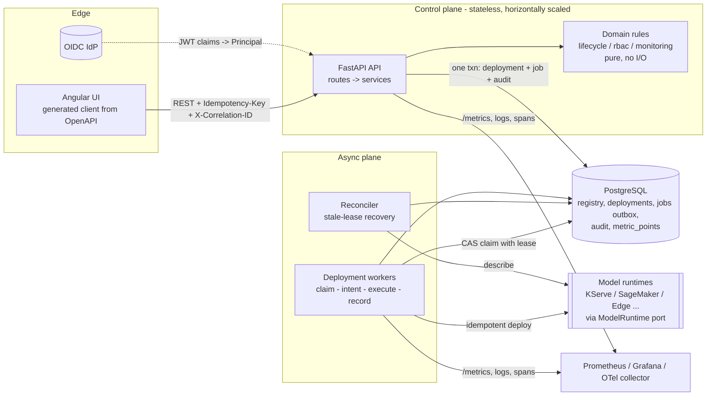
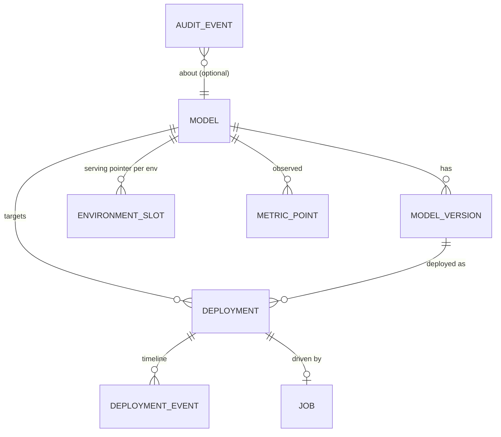
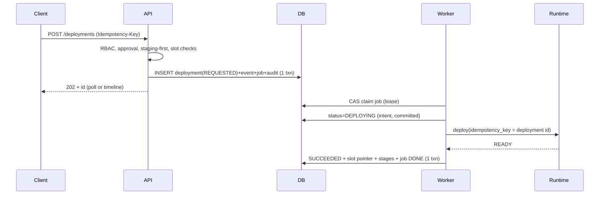
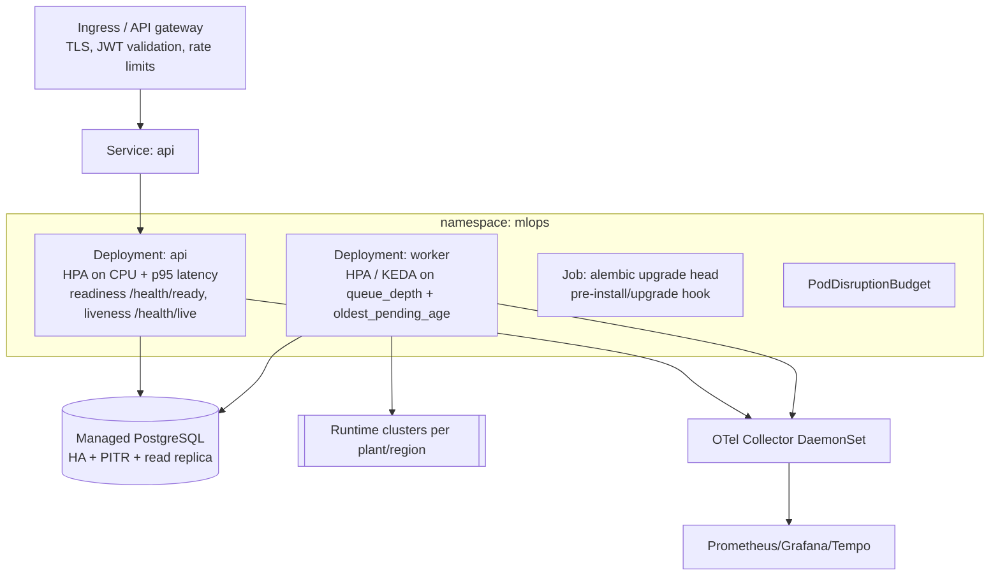

# Architecture (G12)

Legend: **[Implemented]** is in the repo and covered by tests. **[Designed]** is specified here, not built.

## Context

An industrial organization runs many ML models across plants and environments. The platform is the
control plane: it registers and versions models, gates promotion behind approval, executes
deployments against external serving runtimes, and surfaces monitoring. It does not serve
predictions and does not train models.

## Scope

In: registry, lifecycle, governed async deployment, retry/rollback, monitoring ingest and query,
audit, RBAC, multi-tenancy, observability. Out of this submission: the Angular UI (see
[known-limitations.md](known-limitations.md)); the API is the contract it would consume.

## Architecture overview

Authentication boundary: only `api/deps.py` knows how identity is established. Everything below it sees
a `Principal(user, role, tenant_id)`. The dev adapter reads headers; production swaps in verified
JWT claims without touching services.

## Components and ownership boundaries

| Module | Responsibility | May depend on | Natural owner |
|---|---|---|---|
| `domain/` | State machines, promotion policy, rollback planning, RBAC matrix, metric classification. Pure functions. | nothing | Platform core |
| `services/registry_service` | Model/version CRUD + validate/approve/reject/archive | domain, orm | Registry team |
| `services/deployment_service` | Request/retry/rollback: policy checks, idempotency, enqueue | domain, orm, runtime port | Deployment team |
| `worker.py` | Async execution, retries, backoff, reconciliation | domain, orm, runtime port | Deployment team |
| `runtime/` | `ModelRuntime` port + adapters | domain errors | Runtime-integration team (one adapter per runtime) |
| `services/metrics_service` | Ingest + read-side aggregation | domain, orm | Monitoring team |
| `api/` | HTTP, schemas, error envelope, authn edge | services | API/Frontend contract owners |
| `observability.py` | Logs, correlation, metrics, spans | - | SRE/platform |

Dependency direction is strictly inward (api -> services -> domain). `domain/` imports nothing from the
rest of the app, so rules cannot silently drift into handlers.

## Domain model

Every table carries `tenant_id`. `ENVIRONMENT_SLOT(tenant, model, env).current_deployment_id` is the single
source of truth for "what is serving"; version `stage` is derived from slots, never set by hand.

## Key workflows

**Deploy (async)**

**Rollback**: `POST /deployments/{id}/rollback` creates a *new* ROLLBACK deployment toward the last
safe version through the same governed async path; on success the original becomes ROLLED_BACK.
History is never rewritten.

## Synchronous vs asynchronous rationale

| Operation | Mode | Why |
|---|---|---|
| Registry CRUD, approvals, reads, metric queries | Sync | Fast, local DB, user needs immediate result and validation errors |
| Deployment, retry, rollback | **Async** (202 + job) | Runtime calls take seconds-minutes, fail transiently, and must survive API restarts; holding an HTTP request open couples API capacity to runtime latency |
| Metric ingest | Sync write, idempotent batch | Cheap; at scale becomes queue-fronted (see Scaling) |

## Persistence, caching, queueing, concurrency

- **Persistence [Implemented]**: PostgreSQL (SQLite for local/test). Alembic migrations; `alembic check` in CI proves models == schema.
- **Queue [Implemented]**: `jobs` table as a transactional outbox. Enqueue is atomic with the deployment row, so there is no "saved but never queued" state and no dual-write. Claim is a portable compare-and-swap with a lease; works with N workers without `SKIP LOCKED`.
- **Concurrency [Implemented]**: enforced by the database, not check-then-act:
  1. partial unique index `uq_active_deployment_per_slot`: one in-flight deployment per (tenant, model, env);
  2. unique `(tenant, idempotency_key)`;
  3. optimistic `row_version` on versions, deployments, slots (lost update -> 409 `CONCURRENT_MODIFICATION`).
  The service pre-checks only to give friendly errors; the indexes are the guarantee. Tests race threads against both SQLite and PostgreSQL.
- **Caching [Designed, deliberately not built]**: all hot reads are indexed and tenant-scoped. First cache would be short-TTL (15-30 s) `GET /models/{id}/metrics` summaries keyed by (tenant, model, env, window) plus HTTP `ETag`s on registry reads. No cache sits on any write or policy path, so staleness can never cause an unsafe promotion.

## Kubernetes / equivalent deployment view [Designed; docker-compose is Implemented]

API and worker share one image with different commands so they scale on different signals. Secrets
come from the cluster secret store; `terminationGracePeriodSeconds` exceeds `runtime_timeout_s` so a
draining worker finishes or lets the lease expire (reconciliation covers the rest).

## Reliability

- At-least-once execution with effectively-once outcomes: runtime calls are idempotent on the deployment id.
- Intent is committed (DEPLOYING) before any external side effect; success is recorded in one transaction.
- Crash/DB-failure after external success is repaired by lease expiry + `describe()` reconciliation (Question 3).
- Transient failures retry with exponential backoff up to `job_max_attempts`; permanent/policy failures stop immediately.
- `/health/ready` fails (503) if the DB is unreachable; `/health/live` never depends on dependencies.

## Security

- RBAC with separation of duties (developer cannot approve; approver cannot deploy; registrant cannot approve own version; production needs a stronger permission than staging).
- Tenant scoping on every query; cross-tenant ids return 404 (no existence leak).
- Append-only audit (ORM guard + Postgres trigger).
- Failure simulation is a config flag, off in real environments. No secrets in the repo; `.env.example` only.
- Artifact URIs restricted to allowed schemes at validation time. [Designed] Next: artifact signature/digest verification and SBOM/scan results as validation gates.

## Observability

See [observability.md](observability.md).

## Scaling

See [g12-questions.md](g12-questions.md) Q1, Q6. Summary: API is stateless; workers scale on queue age;
PostgreSQL is the only stateful tier. The first things to change at 10k models are the metric store
and the queue transport, both already behind narrow seams.

## Trade-offs and rejected alternatives

See [adr/](adr/) for the decisions; short form:

| Decision | Chosen | Rejected | Why |
|---|---|---|---|
| Async execution | DB-backed outbox queue + polling workers | Celery+Redis/RabbitMQ; Kafka; FastAPI BackgroundTasks | One fewer stateful system to run and fail; atomic enqueue; BackgroundTasks lose work on restart (ADR-001) |
| Promotion conflicts | DB partial unique index + CAS | Distributed locks (Redis/ZooKeeper); app-level `SELECT ... FOR UPDATE` only | Lock service is another failure mode; the invariant belongs where the data lives (ADR-002) |
| Runtime integration | Port + idempotent adapters + describe() reconciliation | Two-phase commit; saga with compensations | No runtime supports 2PC; idempotency + reconciliation is simpler and testable (ADR-003) |
| Tenancy | Shared schema, `tenant_id` everywhere | Schema-per-tenant; DB-per-tenant | Operational cost at 100s of tenants; RLS is the hardening path (ADR-004) |
| Sync SQLAlchemy | Sync endpoints in threadpool | Fully async stack | Simpler transactions/testing; DB is the bottleneck, not the event loop |
| Cache | None yet | Redis in front of reads | No measured need; avoids stale-policy risk |
