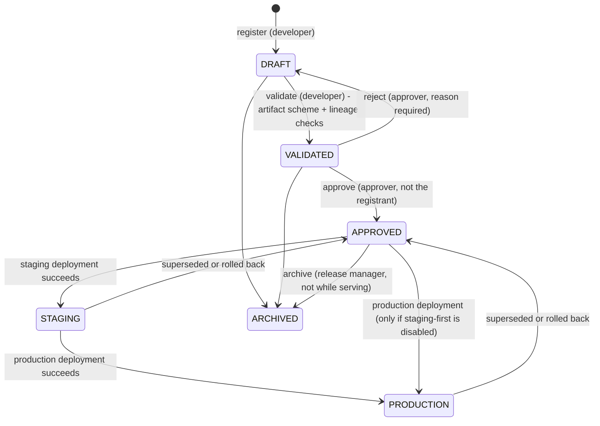

# Governance

All rules are **Implemented** and tested unless marked otherwise. The rules live in `backend/app/domain/` as pure functions.

## Approval and promotion workflow

`STAGING`/`PRODUCTION` are *derived* from the environment slots after each successful deployment, so a version's stage cannot disagree with what is actually serving.

Environment promotion controls:
- Any deployment needs `approval_status = APPROVED` and a non-archived version.
- Production additionally needs a prior successful staging deployment of the same version (`MLOPS_REQUIRE_STAGING_BEFORE_PRODUCTION`, default on) and the stronger `deploy:production` permission.
- Policy is re-checked by the worker at execution time, so approval revoked or a version archived between request and execution fails the deployment as `POLICY` instead of shipping it.

## Role-based authorization

| Permission | viewer | developer | approver | release_manager | service | admin |
|---|:-:|:-:|:-:|:-:|:-:|:-:|
| `model:read` | x | x | x | x | x | x |
| `model:write` (register model/version) | | x | | | | x |
| `version:validate` | | x | | | | x |
| `version:approve` (approve/reject) | | | x | | | x |
| `version:archive` | | | | x | | x |
| `deploy:staging` (deploy, retry, rollback) | | x | | x | | x |
| `deploy:production` | | | | x | | x |
| `metrics:write` | | x | | | x | x |
| `audit:read` | | | x | | | x |

Separation of duties: nobody who lacks `version:approve` can approve; approvers cannot deploy; **the registrant cannot approve their own version, even as admin** (`SELF_APPROVAL_FORBIDDEN`). Authorization happens in the service layer (not only in routes), so any future entry point (CLI, gRPC, worker-driven action) inherits it.

## Idempotency

| Case | Behaviour |
|---|---|
| Same `Idempotency-Key`, same request | Returns the original deployment, HTTP 200 + `Idempotent-Replay: true`. No second job. |
| Same key, different request | 422 `IDEMPOTENCY_KEY_REUSED` |
| Concurrent twins with the same key | One 202, the rest replay (unique constraint `(tenant, key)`; loser re-reads the winner) |
| No key, identical request while in flight | 409 `DEPLOYMENT_IN_PROGRESS` (slot index) |
| No key, version already serving | 409 `VERSION_ALREADY_ACTIVE` |
| Metric re-send | `ON CONFLICT DO NOTHING`; `inserted: 0` |
| Runtime call | Keyed by deployment id; replays are no-ops |

## Concurrency strategy

See [architecture.md](architecture.md#persistence-caching-queueing-concurrency): partial unique index + idempotency unique constraint + optimistic `row_version`, plus a CAS job claim with lease. Rule of thumb used throughout: *the database enforces the invariant; Python code only produces friendly errors.*

## Rollback safety

Seven refusal conditions, enumerated in [g12-questions.md](g12-questions.md#7-how-is-unsafe-rollback-prevented). Rollback is a new deployment (kind `ROLLBACK`), so it is audited, idempotent, retried and observable like any other.

## Audit history

- `audit_events`: who (user, role), what (`action`), which entity, `before`/`after` snapshots, `correlation_id`, timestamp. Written in the **same transaction** as the change, so there is no change without an audit record and no audit record for a rolled-back change.
- `deployment_events`: per-deployment timeline (every state transition, retry, reconciliation, failure class), used by the UI event timeline.
- Append-only: ORM listener rejects UPDATE/DELETE; PostgreSQL trigger does the same at the database (verified against PostgreSQL). `GET /audit` requires `audit:read`.
- [Designed] ship audit to WORM storage / SIEM; hash-chain rows for tamper evidence.
